## Hi there 👋

### Welcome to my Developer Dashboard

---

## About Me

- BCA Student
- Full Stack Developer in Training
- Interested in AI and Cloud Computing
- Building real-world software applications

---

## Technologies & Skills

---

## GitHub Analytics Dashboard

<picture>
  <source media="(prefers-color-scheme: dark)" srcset="./assets/cards.dark.svg"/>
  
</picture>

---

## Contribution Snake

<picture>
  <source media="(prefers-color-scheme: dark)" srcset="https://raw.githubusercontent.com/shailendra320/shailendra320/output/snake-dark.svg"/>
  
</picture>

---

## Explore My Projects

### Learn • Code • Build • Repeat

