## Hi there 👋

 

---

## 01 / Developer Profile

I am a BCA student and aspiring Full Stack Developer
passionate about building modern, scalable and
user-friendly software applications.

- Software Development
- Full Stack Web Development
- Artificial Intelligence
- Cloud Computing
- Database Management

---

## 02 / Technology Stack

### Programming Languages

### Frontend Development

### Backend & Database

### Developer Tools

---

## 03 / GitHub Analytics

---

## 04 / Activity Graph

---

## 05 / Coding Streak

---

## 06 / Contribution Animation

---

## 07 / Project Portfolio

| Project | Technology |
| :--- | :--- |
| AI Business Platform | Flask & PostgreSQL |
| Vandana Learning | React Native |
| Attendance Management | Python & SQLite |
| Bus Reservation System | Java |
| Personal Portfolio | HTML, CSS & JS |

---

**BUILD. LEARN. IMPROVE. REPEAT.**

## About Me

- BCA Student
- Full Stack Developer in Training
- Interested in AI and Cloud Computing
- Building real-world software applications

---

## Technologies & Skills

---

## GitHub Analytics Dashboard

<picture>
  <source media="(prefers-color-scheme: dark)" srcset="./assets/cards.dark.svg"/>
  
</picture>

---

## Contribution Snake

<picture>
  <source media="(prefers-color-scheme: dark)" srcset="https://raw.githubusercontent.com/shailendra320/shailendra320/output/snake-dark.svg"/>
  
</picture>

---

## Explore My Projects

### Learn • Code • Build • Repeat

